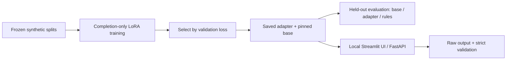

# AdapterForge

Actual LoRA fine-tuning of a small pretrained language model for English support-ticket extraction, with frozen dataset splits, unchanged-base and rule baselines, strict raw-output scoring, a local UI and an inference API.

Local run-v1: **64/64** exact matches on synthetic held-out wrapper templates and **6/8** on authored challenges. Rules scored 59/64 and 5/8 respectively; unchanged base did not meet the strict raw JSON contract. These small synthetic results do not establish customer-data accuracy. See the [model card and preserved failures](MODEL_CARD.md), [verification scope](VALIDATION.md) and [frozen full report](benchmarks/run-v1.json).

## Task

Input: an English support request. Output: JSON with exactly `intent`, `urgency`, and `order_id`. The JSON parser does not strip Markdown, fix syntax, guess missing fields or replace predictions with rules. A separate deterministic validator flags unsupported order IDs.



The base is [HuggingFaceTB/SmolLM2-135M-Instruct](https://huggingface.co/HuggingFaceTB/SmolLM2-135M-Instruct), Apache-2.0, pinned to revision `12fd25f77366fa6b3b4b768ec3050bf629380bac`. Its documented limitations still apply. Base files are downloaded from that immutable revision; safetensors weights are checked against the model repository's LFS SHA-256. Remote model code is never enabled.

## Setup (Windows, Python 3.11)

Use the [official PyTorch installation guidance](https://pytorch.org/get-started/locally/) for hardware compatibility. On the verified RTX 3050 Laptop configuration:

```powershell
python -m venv .venv
.\.venv\Scripts\python.exe -m pip install --upgrade pip
.\.venv\Scripts\python.exe -m pip install --timeout 120 --resume-retries 8 torch==2.10.0 --index-url https://download.pytorch.org/whl/cu128
.\.venv\Scripts\python.exe -m pip install -r requirements.txt
.\.venv\Scripts\python.exe download_model.py
.\.venv\Scripts\python.exe -m unittest discover -s tests -v
```

The CUDA wheel is approximately 2.9 GB; expanded dependencies and the base model need additional disk space. For CPU-only systems install torch from the official CPU index instead. A CUDA build needs a compatible NVIDIA driver; CPU is slower. The project neither rents GPUs nor calls a paid inference API.

`requirements-lock-windows.txt` records the exact local Windows/CUDA verification environment. To reproduce it, use `pip install -r requirements-lock-windows.txt --extra-index-url https://download.pytorch.org/whl/cu128` inside a separate Python 3.11 environment. It is not a portable CPU/Linux lock. The bounded requirements above support the CPU CI/Docker setup separately; hosted CI execution is not implied by local verification.

## Train and evaluate

```powershell
.\.venv\Scripts\python.exe train.py --device auto --output private/run-v1
.\.venv\Scripts\python.exe evaluate.py --adapter private/run-v1/best --output reports/comparison.json
```

An existing training output directory is never overwritten; choose `private/run-v2` for a new experiment. Default training uses 10 epochs, microbatch 4, accumulation 4, seed 27, LoRA rank 16/alpha 32 on q_proj/v_proj, and AdamW learning rate 0.001. Only LoRA parameters are trainable. Completion-only labels mask the prompt and padding. Gradient accumulation is weighted by actual completion-token counts, including partial groups.

Train and validation losses are logged each epoch. Only minimum validation completion-token loss selects `best/`; test/challenge generation is run after selection. Data/source hashes and the training configuration are saved. Model weights stay float32, with bfloat16 autocast when supported on CUDA. Test results must not be used to silently revise this experiment.

The evaluator compares the same examples under the base model with adapters disabled, the trained adapter enabled, and an explicit handcrafted rule baseline. It reports raw-JSON validity, schema validity, field accuracy, exact match, and non-null field micro-F1. Invalid schema counts as a missing prediction for all fields. Batched generation timings are not request-latency or load-test measurements.

See [DATA_CARD.md](DATA_CARD.md) and the [Vietnamese usage guide](HUONG_DAN.md). Synthetic held-out wrapper templates and order IDs do not establish independent real-customer generalization. Preserve failures and include the rule reference even if it outperforms the trained model.

## Local UI and API

```powershell
.\.venv\Scripts\python.exe -m streamlit run app.py --server.address 127.0.0.1 --server.port 8517
```

The UI loads only local verified files and saved adapters; it does not train or repair outputs. Different adapter versions can be selected. A checksum warning identifies a comparison report belonging to another adapter.

After training, `python verify_local.py` exercises the actual saved adapter through FastAPI's in-process test client and Streamlit's application test runner. This is separate from the mocked unit tests and from the held-out accuracy evaluation. It checks one request, not browser appearance, HTTP transport or production load.

Run the API from this project directory:

```powershell
.\.venv\Scripts\python.exe -m uvicorn api:app --host 127.0.0.1 --port 8000 --workers 1
```

Open http://127.0.0.1:8000/docs. `/extract` accepts only a bounded text field and rejects a second simultaneous inference with 503 rather than allowing an unbounded application queue. The default service loads `private/run-v1/best`; adjust its fixed configuration deliberately for another release. No authentication, external deployment or SLA is provided. Do not expose this demo publicly as-is.

## Optional Docker scaffold

`Dockerfile` serves on CPU and excludes private artifacts from its build context. Build locally, then mount the prepared private directory read-only and bind the published port to loopback. Docker execution is separate from the local GPU verification and must be tested on the target environment before claiming it works there.

## Artifacts and privacy

`private/` holds pinned model files and adapter artifacts; `reports/` holds new local comparisons/failures. Both are ignored. The frozen initial synthetic evaluation is preserved publicly under `benchmarks/`. Public data files are synthetic. There is no upload of requests or adapters to an inference service. User inputs/model instances may remain in local Streamlit session/cache memory. Do not submit real customer information to this prototype.

Training code uses [PEFT LoRA](https://huggingface.co/docs/peft/main/en/package_reference/lora). Published model metrics must come from the actual saved report, not from unit-test counts or mocked UI/API tests. Publication instructions remain outside this repository.
